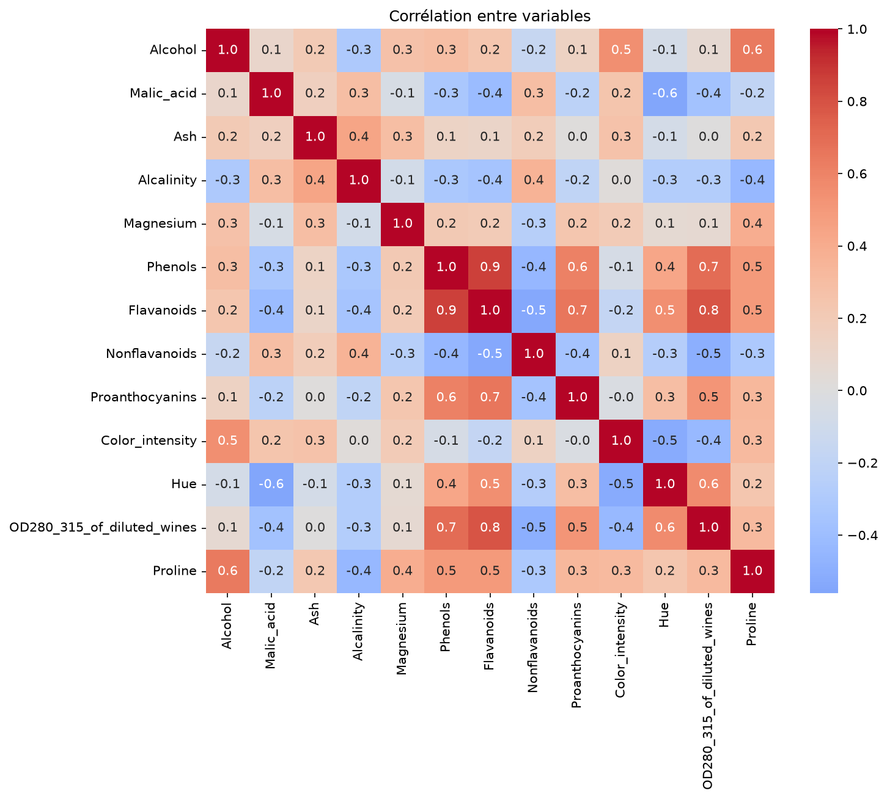
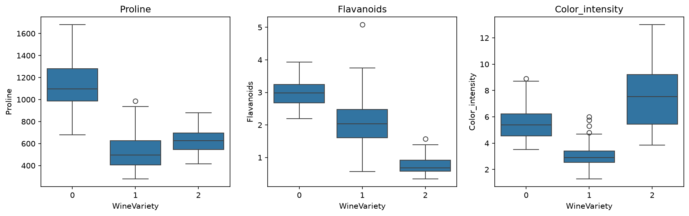
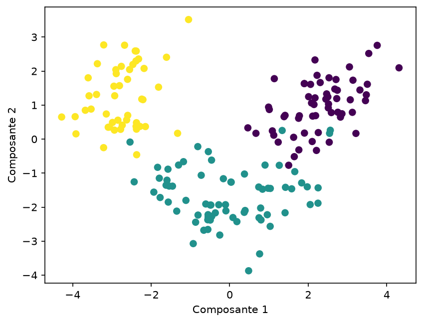
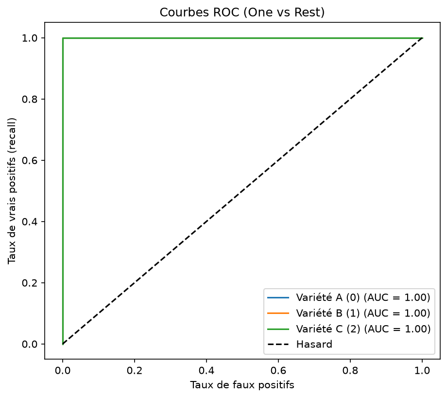

# Classification des vins par cépage

Défi de classification multiclasse (module Machine Learning).
Objectif : classer des vins selon leur cépage à partir de leur composition chimique, avec un **recall global > 0,95**.

## Données
- 178 échantillons, 13 variables chimiques (alcool, proline, flavonoïdes, etc.)
- Label `WineVariety` : 3 classes (0 : 59, 1 : 71, 2 : 48 échantillons)
- Classes assez équilibrées, sans rééquilibrage nécessaire
- Source : UCI Machine Learning Repository (Forina et al.)

## Exploration visuelle

### Corrélation entre variables

Certaines variables sont fortement corrélées, notamment les flavanoïdes, les phénols et l'OD280 : elles portent en partie la même information. D'autres variables restent peu liées aux autres et apportent une information distincte.

### Variables selon la variété

La proline, les flavanoïdes et l'intensité de couleur diffèrent nettement d'une variété à l'autre. La proline est beaucoup plus élevée pour la variété 0, les flavanoïdes sont les plus faibles pour la variété 2, et l'intensité de couleur est la plus basse pour la variété 1. Ces variables permettent déjà de bien distinguer les cépages.

### Projection PCA en 2D

En réduisant les 13 variables à 2 composantes, les 3 variétés forment des groupes bien séparés, avec peu de chevauchement. Cela annonce qu'un modèle simple suffira.

## Démarche
1. Exploration des données (dimensions, colonnes, répartition des classes)
2. Découpage 70 % entraînement / 30 % test (stratifié)
3. Standardisation des variables (`StandardScaler`), car les échelles sont très différentes (ex. proline ~1000)
4. Modèle : régression logistique (gère le multiclasse)
5. Évaluation : rapport de classification, matrice de confusion, recall, courbes ROC
6. Validation croisée à 5 plis pour confirmer la stabilité
7. Sauvegarde du modèle (`joblib`) et prédiction sur 2 nouveaux échantillons

## Résultats
- Recall global sur le jeu de test : **1,0** (aucune erreur sur 54 échantillons)
- Validation croisée (5 plis) : scores entre 0,97 et 1,0, **moyenne 0,985**
- Le modèle dépasse largement l'objectif de 0,95.

### Courbes ROC (One vs Rest)

Chaque courbe oppose une variété aux deux autres. Les trois courbes se collent au coin supérieur gauche, avec des AUC proches de 1 ([indiquer tes valeurs]), très loin de la diagonale du hasard. Le modèle sépare donc très bien les trois cépages.

### Prédictions sur de nouveaux échantillons
- Échantillon 1 : variété **0 (A)**
- Échantillon 2 : variété **1 (B)**

## Limites
- Jeu de données petit (178 échantillons) et plutôt facile à séparer : le score parfait est à interpréter avec prudence.
- Pour le confirmer, on a utilisé une validation croisée, qui donne un résultat un peu plus bas (0,985) mais stable.

## Fichiers
- `Wine Classification Challenge.ipynb` : notebook complet (code et résultats)
- `wine.csv` : données
- `images/` : graphiques utilisés dans ce README

## Auteurs
Bentrad Roudeina et Abdellatif Oumaima